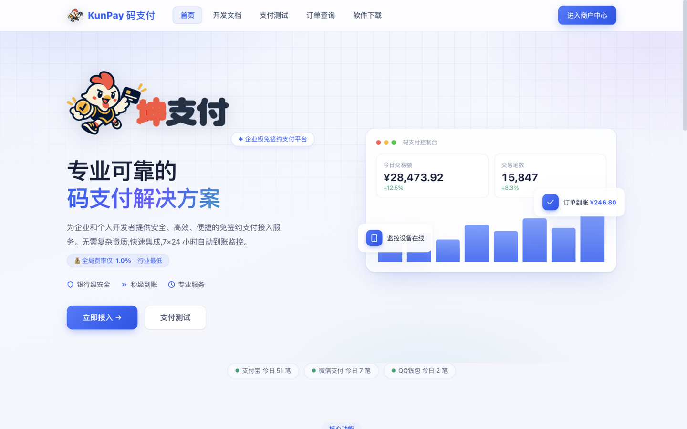
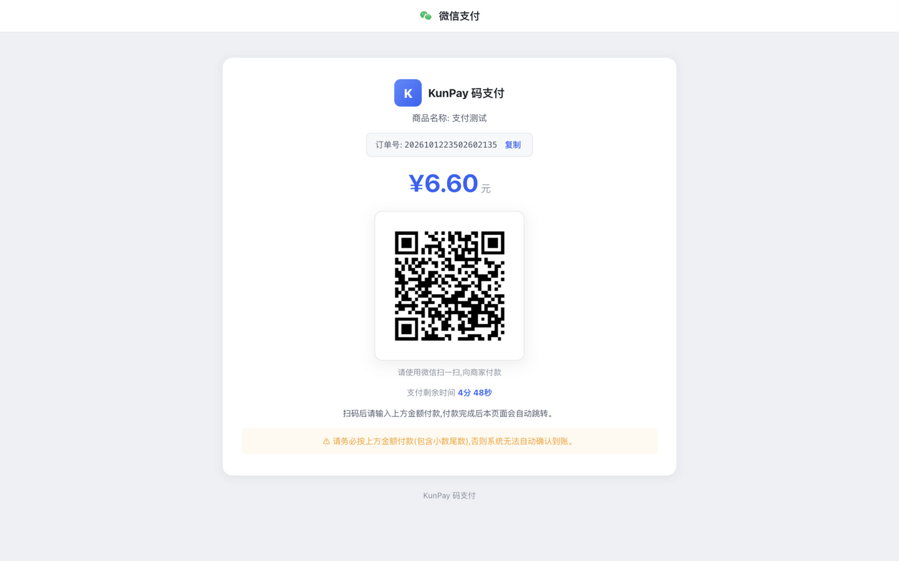
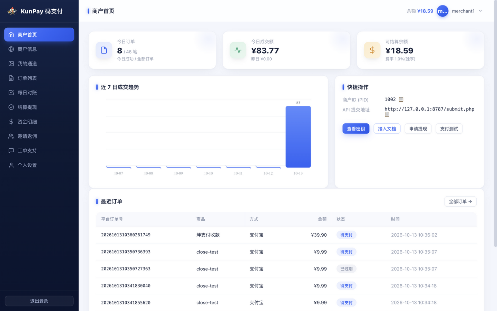
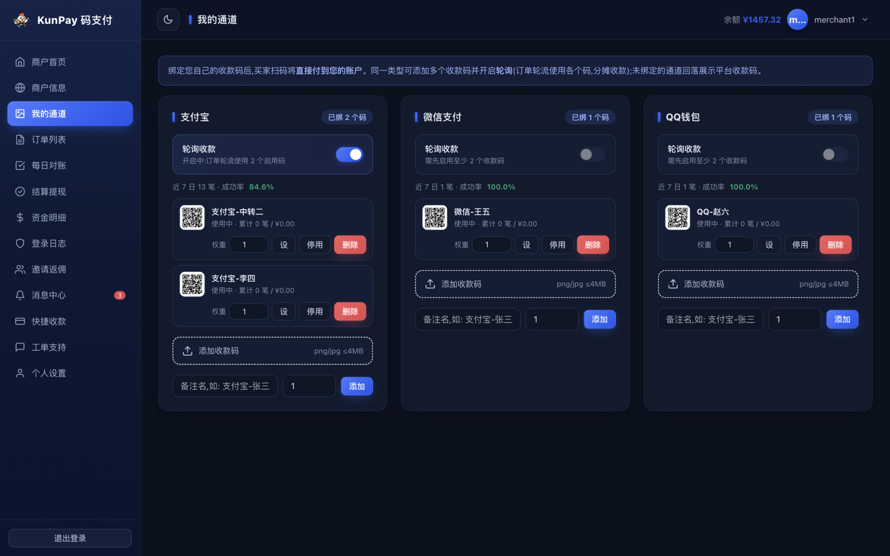
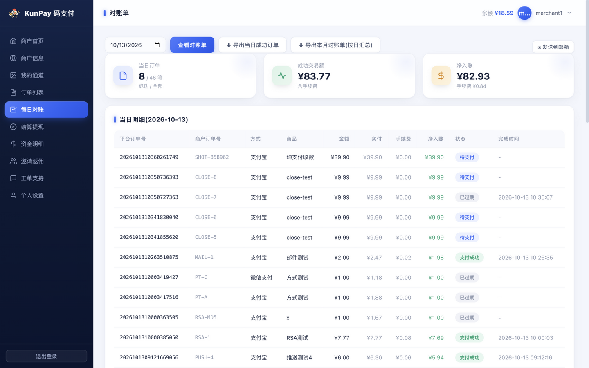
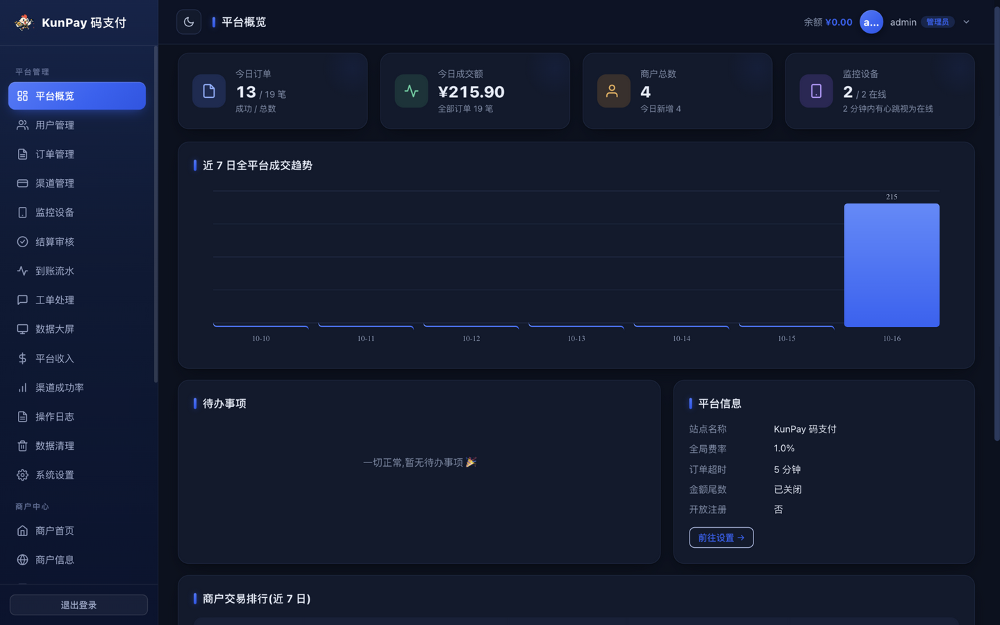
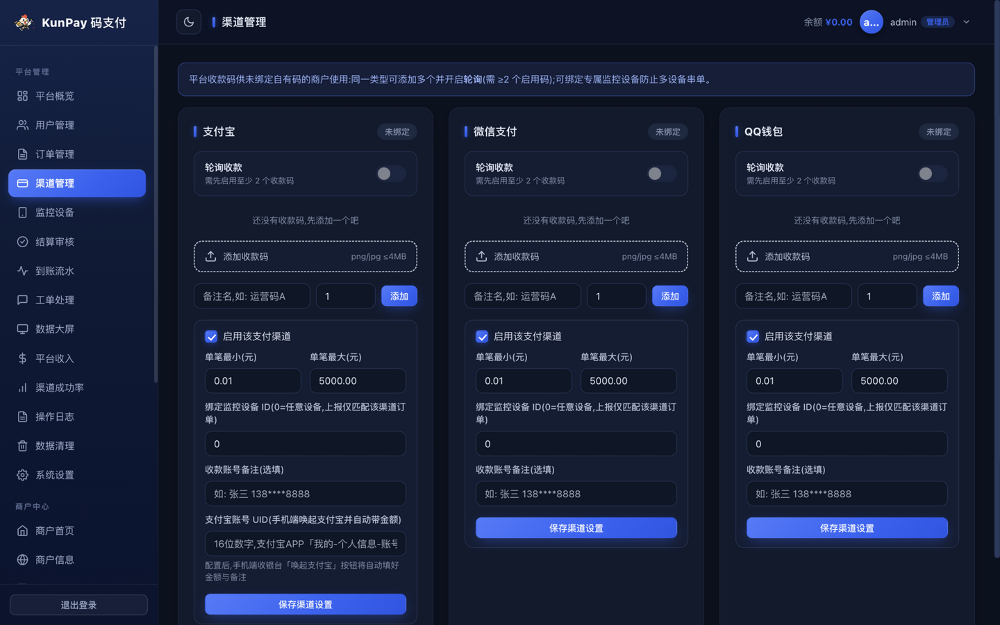
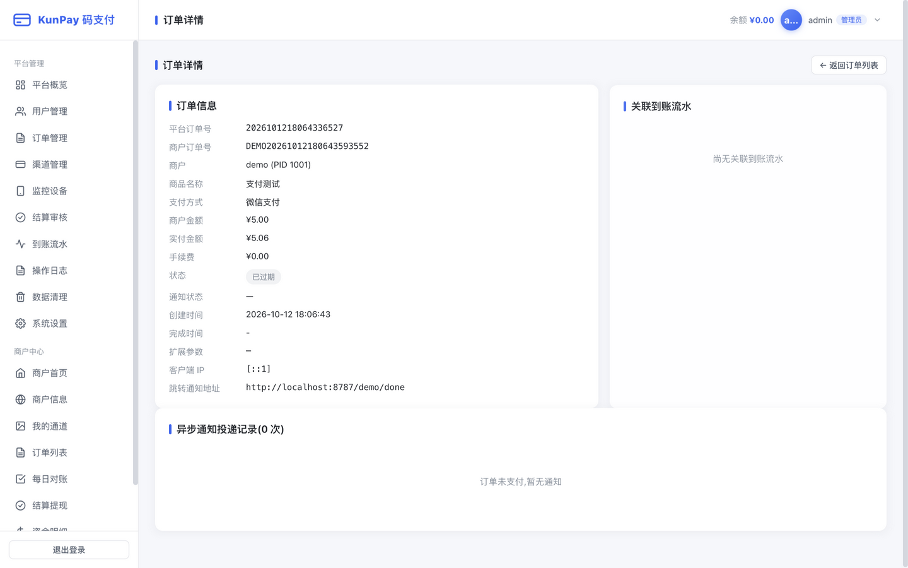
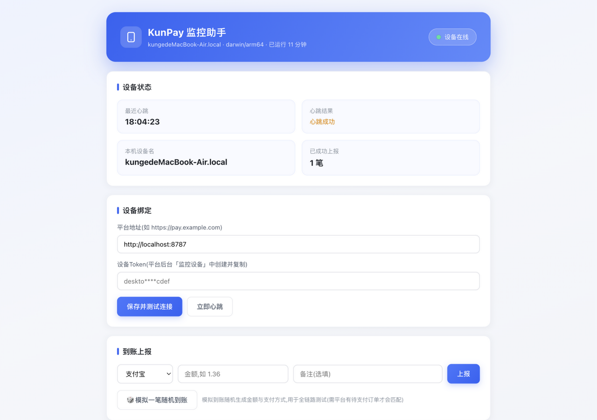
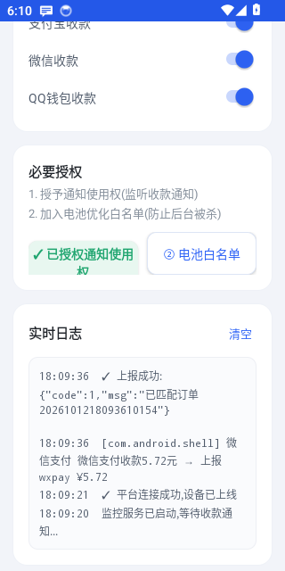

# 坤支付 KunPay

<p align="center">
  <b>开源个人免签约码支付系统 · Go 语言单文件部署</b><br>
  易支付协议兼容 · 个人收款码自动监控 · 多码轮询 · 三平台监控客户端
</p>

一套使用 **Go 语言**开发的个人免签约「码支付」平台,参考 SHMPAY(xpay)风格实现。
编译产物为**单个二进制文件**(前端页面、静态资源、SQLite 驱动全部内嵌),支持 **Windows / Linux / macOS** 一键部署,无需安装任何依赖。
配套**收款监控客户端全家桶**:安卓APP(自动监听收款通知)、Windows/macOS 监控助手(心跳保活+上报控制台)。

> ⚠️ **免责声明**:本项目仅供学习研究。支付业务受严格监管,请勿用于违法违规场景,正式商用请自行评估合规风险并取得相关资质。详见 [LICENSE](LICENSE) 附加条款。

## 💎 赞助商

<table>
  <tr>
    <td align="center" width="280">
      <a href="https://www.kjvps.com" target="_blank"><b>KJ VPS</b></a><br>
      <sub>跨境 VPS 服务商 · 高速稳定 · 全球节点</sub><br>
      <a href="https://www.kjvps.com" target="_blank">www.kjvps.com</a>
    </td>
  </tr>
</table>

> 感谢 **[KJ VPS](https://www.kjvps.com)** 为本项目提供跨境 VPS 支持。

## ⬇ 快速下载

| 下载 | 说明 |
|---|---|
| [**📱 安卓监控APP (APK)**](https://github.com/kungec/kunpay/releases/download/v1.0.0/KunPayMonitor.apk) | 自动监听微信/支付宝/QQ收款通知,安装即用 |
| [**💻 Windows 监控助手**](https://github.com/kungec/kunpay/releases/download/v1.0.0/KunPayMonitor_win64.zip) | 心跳保活 + 手动上报控制台 |
| **🖥 平台主程序** | [Linux](https://github.com/kungec/kunpay/releases/download/v1.0.0/kunpay_linux_amd64.tar.gz) · [Windows](https://github.com/kungec/kunpay/releases/download/v1.0.0/kunpay_windows_amd64.zip) · [macOS](https://github.com/kungec/kunpay/releases/download/v1.0.0/kunpay_darwin_arm64.tar.gz) |

> 更多版本与源码见 [Releases](https://github.com/kungec/kunpay/releases) 页面。

## 云端挂机

监控不依赖家里开机:把安卓监控APP跑在**云手机**上实现 7×24 自动监听,Windows/macOS 监控助手注册为系统服务跑在云服务器做心跳保活;平台内置**主备设备自动接管**——主设备离线 5 分钟,备份设备自动接管匹配,双保险不掉单。

详见 **[deploy/云端挂机部署指南.md](deploy/云端挂机部署指南.md)**(云手机 / 云服务器 / 主备双保险三套方案 + 各平台服务化脚本)。

## 界面预览

| 平台首页 | 收银台 |
|---|---|
|  |  |

| 商户中心 | 监控通道(多码轮询) |
|---|---|
|  |  |

| 每日对账单 | 管理后台 |
|---|---|
|  |  |

| 渠道管理(轮询+统计) | 订单详情(通知投递排障) |
|---|---|
|  |  |

| 监控助手(桌面) | 监控APP(安卓) |
|---|---|
|  |  |

## 收款监控客户端

| 端 | 产物 | 功能 |
|---|---|---|
| 安卓 | `monitor-android/KunPayMonitor.apk` | **自动监控**:监听微信/支付宝/QQ收款通知,自动提取金额上报;30秒心跳;三通道独立开关;实时日志 |
| Windows / macOS / Linux | `dist/monitor/KunPayMonitor_*` | 心跳保活(设备常在线)、手动/模拟到账上报、本地 Web 控制台,用于联调与保号 |

安卓端使用:安装 APK → 填平台地址与设备Token → 授予通知使用权 + 电池白名单 → 保持后台运行。
桌面端使用:运行后自动打开浏览器控制台(127.0.0.1:8210),填入地址与 Token 即可。
构建:安卓端 `monitor-android/build-android.sh`(需 JDK17 + Android build-tools);桌面端 `bash build-monitor.sh`。

## 功能总览

### 商户侧(易支付协议全兼容)
- 商户注册 / 登录,自动分配商户 ID(PID)与商户密钥(KEY)
- **submit.php** 页面跳转支付(GET/POST,302 跳转收银台)
- **mapi.php** API 接口支付(返回 JSON:payurl / qrcode / img base64)
- **api.php** 商户信息查询、单个订单查询、批量订单查询
- 标准 **MD5 签名**(ASCII 升序、过滤空值与 sign 字段、末尾拼接 KEY)
- 支付成功 **notify_url 异步通知**(失败自动重试 8 次:15s→30s→1m→3m→10m→30m→1h→2h),商户回复 `success` 确认
- **return_url 跳转通知**(支付完成后收银台自动跳转,携带签名参数)
- 收银台:收款二维码 + 应付金额(尾数偏移)+ 倒计时 + 轮询自动跳转

### 商户增值
- **我的通道**:商户绑定自有收款码(同类型可多个),收银台优先展示;支持**轮询收款**(≥2 个启用码自助开启,按订单号取模确定性轮换);每个码独立统计累计笔数/金额
- **每日对账单**:任意日期汇总(笔数/交易额/手续费/净入账)+ 明细,可导出 CSV / 发送到邮箱
- 订单 CSV 导出(商户/管理员)
- 未匹配到账流水管理员**手动匹配订单**;订单支持**重发异步通知**

### 码支付核心(个人码收款)
- **金额尾数匹配引擎**:整数金额自动追加 0.01~0.99 随机尾数,保证同刻在途订单金额唯一,监控到账按「支付方式+金额」精确匹配;支持从通知内容中识别订单号优先匹配
- **监控设备管理**:添加设备生成 Token,心跳在线检测(2 分钟)
- **双协议监控上报**,兼容 V免签(vmq)监控APP:
  - 自有协议:`GET /monitor/heart?token=`、`GET /monitor/push?token=&type=&money=&content=`
  - vmq 兼容:`GET /appHeart?t=&sign=md5(t+token)`、`GET /appPushV?...`
- 到账流水:每笔上报全记录,未匹配流水标红提示
- 订单超时自动作废(默认 5 分钟,可配置),管理员**手动补单**(入账+通知一步完成)

### 商户中心
- 仪表盘:今日订单/成交额、余额、近 7 日趋势图、最近订单
- 商户信息:PID/KEY 展示复制、接口地址、一键重置密钥、接入示例
- 订单列表:按订单号/状态/支付方式筛选、分页、通知状态
- 结算提现:余额申请提现、最低提现额、提现记录、拒绝自动退回
- 资金明细:订单入账 / 提现支出 / 提现退回 / 管理员调整全流水
- 个人设置:邮箱/QQ/结算账号维护、修改密码

### 管理后台
- 平台概览:今日交易、商户数、设备在线数、7 日全平台趋势、待办提醒
- 用户管理:搜索、封禁/解封、专属费率、余额调整、重置密钥/密码
- 订单管理:多维筛选、手动补单、重发异步通知、CSV 导出
- 到账流水:未匹配流水标红,支持手动匹配到指定订单
- 渠道管理:支付宝/微信/QQ 渠道开关、单笔限额、**收款码上传**、绑定监控设备
- 结算审核:打款 / 拒绝退款
- 系统设置:站点信息、全局费率、订单超时、金额尾数开关、注册开关、邀请码、公告、客服等

### 运营与白标
- **平台渠道多码轮询**(与商户轮询同机制)、收款码使用统计(每码累计笔数/金额)
- **品牌 Logo 白标**:上传自有 Logo,站点导航与收银台换肤
- 每日对账单邮件发送、登录防爆破、注册限频、支付接口 IP 限频、安全响应头
- 数据库在线备份下载(自动保留最近 10 份)、旧流水自动清理、系统信息卡
- `deploy/` 内置 Nginx 反代、systemd、Windows 服务部署模板

### 平台页面
- 首页(Hero + 功能区,参考 xpay 风格)、开发文档(10 个章节完整参数表)、支付测试(演示收银台)、登录/注册

## 快速开始

### 本机运行(需要 Go 1.23+)

```bash
go build -o kunpay ./cmd/server
./kunpay -port 8080
```

或直接运行已编译好的二进制(见下方交叉编译)。

### 交叉编译(产出 Windows / Linux / macOS 全平台)

```bash
bash build.sh      # macOS / Linux
build.bat          # Windows(本机版本)
```

产物在 `dist/` 下:

```
kunpay_linux_amd64/kunpay        Linux x64
kunpay_linux_arm64/kunpay        Linux ARM64(如甲骨文/树莓派)
kunpay_windows_amd64/kunpay.exe  Windows x64
kunpay_windows_arm64/kunpay.exe  Windows ARM64
kunpay_darwin_arm64/kunpay       Apple Silicon
kunpay_darwin_amd64/kunpay       Intel Mac
```

每个产物目录附带《部署说明.txt》。

### 部署

```bash
# Linux
chmod +x kunpay
./kunpay -port 8080
```

```
Windows: 双击 kunpay.exe,或 cmd 执行 kunpay.exe -port 8080
```

| 参数 | 环境变量 | 默认 | 说明 |
|---|---|---|---|
| `-port` | KUNPAY_PORT | 8080 | HTTP 监听端口 |
| `-db` | KUNPAY_DB | ./kunpay.db | SQLite 数据库路径 |
| `-data` | KUNPAY_DATA | ./data | 收款码等上传文件目录 |

首次启动自动初始化:

- 管理员:**admin / admin123**(请立即修改)
- 演示商户:demo / demo123(PID 1001,供 /demo 支付测试使用)
- 三个支付渠道(支付宝/微信/QQ,默认开启)

生产环境建议:用 Nginx/Caddy 反代 + HTTPS;数据库与 data 目录随运行目录生成,注意备份;Systemd 示例见产物内部署说明。

## 上线配置流程(管理员)

1. 登录后台 → **渠道管理**:为每个渠道上传你的个人收款二维码
2. **监控设备**:添加设备,复制 Token
3. 在收款手机安装支持 V免签协议的监控APP,配置服务器地址与 Token,开启短信/通知监听
4. **系统设置**:修改站点名称、客服、全局费率、公告等
5. 商户在首页注册 → 商户中心拿 PID/KEY → 按开发文档接入

## 技术栈

- Go 1.23+(标准库 net/http 路由 + html/template)
- SQLite(modernc.org/sqlite 纯 Go 驱动,免 CGO,天生可交叉编译)
- 密码 bcrypt 加密;会话 HttpOnly Cookie + 服务端存储;表单 CSRF 防护
- 全部静态资源 go:embed 内嵌,零外部依赖、零运行时文件(数据库与上传目录除外)

## 目录结构

```
cmd/server/          程序入口
internal/config/     配置
internal/db/         SQLite 初始化、迁移、设置存储
internal/model/      数据模型
internal/service/    签名、订单创建、金额匹配引擎、异步通知、后台任务
internal/web/        HTTP 路由与处理器(epay 兼容层/收银台/用户中心/后台/监控API)
web/templates/       全部 HTML 模板(embed)
web/static/          CSS/JS/图标(embed)
scripts/e2e_test.py  端到端测试(44 项断言)
build.sh/build.bat   交叉编译脚本
```

## 测试

```bash
go vet ./...                       # 静态检查
python3 scripts/e2e_test.py        # 需先以全新数据库启动服务:
                                   # ./kunpay -port 8787 -db /tmp/kunpay-e2e.db -data /tmp/kunpay-data
```

覆盖:注册登录、签名校验(含错误签名拒绝)、submit/mapi 下单、收银台渲染、监控心跳与到账匹配(自有协议 + V免签)、异步通知与验签、api.php 三类查询、余额入账与费率扣减、提现申请/拒绝退款、手动补单、全部页面 200。

## ⚠️ 使用须知

本系统仅用于学习研究或合法合规的自有收款场景。支付行业受严格监管,请勿用于违法违规交易;正式商用请自行评估合规风险并取得相关资质。

## 赞助商

<div align="center">
  <a href="https://www.kjvps.com" target="_blank">
    
  </a>
  <br><sub>跨境 VPS 服务商 · 高速稳定 · 全球节点 — <a href="https://www.kjvps.com">www.kjvps.com</a></sub>
</div>

## 开源与贡献

- License: [MIT](LICENSE)(含支付合规附加声明)
- 欢迎提交 Issue 与 Pull Request;提交前请运行 `go vet ./...` 与 `python3 scripts/e2e_test.py`
- 安卓监控端源码在 `monitor-android/`,可使用 Android Studio 打开或用 `build-android.sh` 构建

## 从源码构建

```bash
# 平台主程序(需要 Go 1.23+)
go build -o kunpay ./cmd/server

# 安卓监控端(需要 JDK17 + Android build-tools,详见脚本内注释)
bash monitor-android/build-android.sh

# 桌面监控助手(Windows/macOS/Linux)
bash build-monitor.sh

# Docker
bash build-docker.sh && docker compose up -d
```
