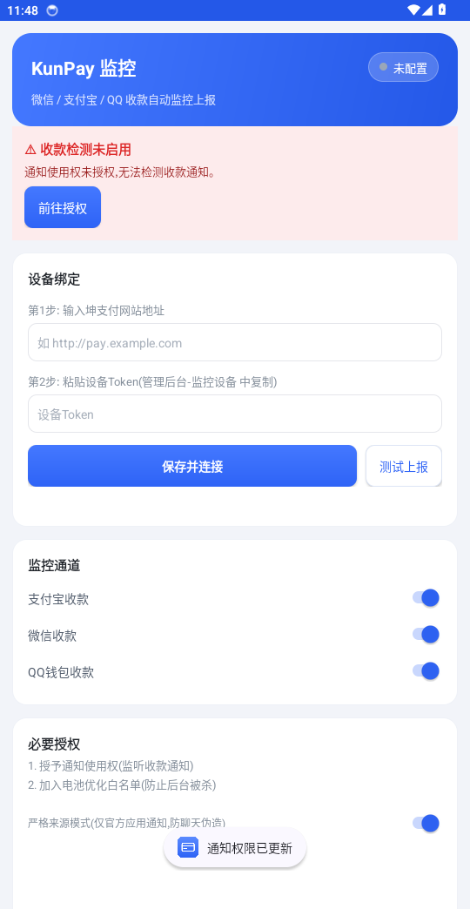
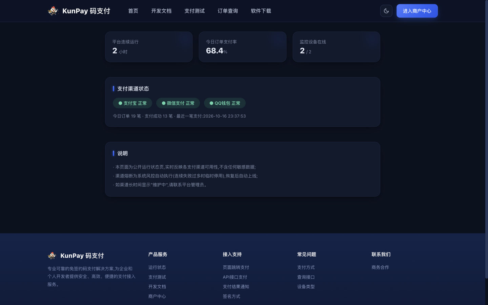
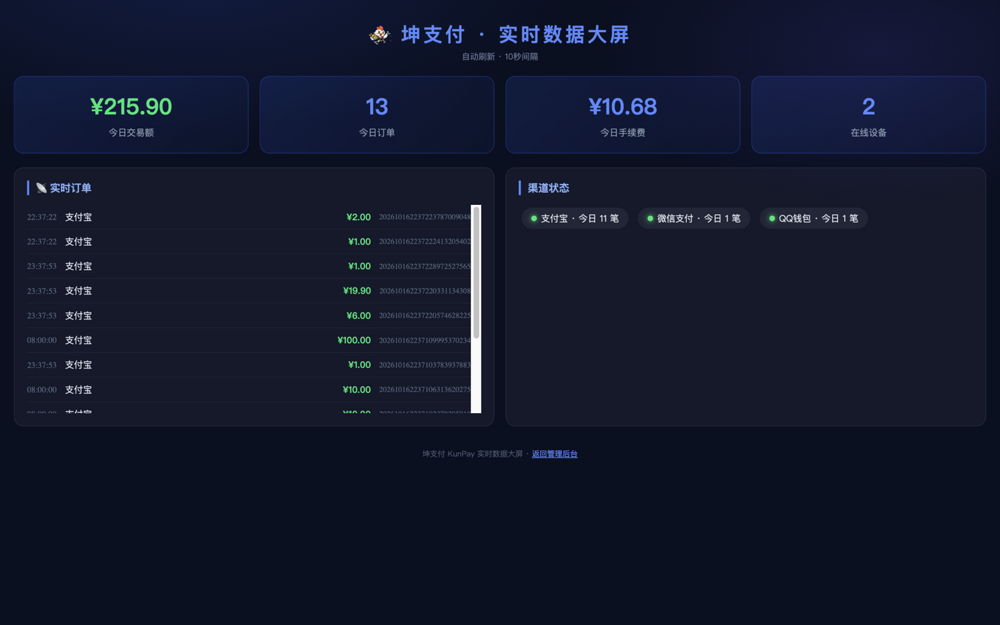

# 坤支付 KunPay

<p align="center">
  <b>开箱即用的个人免签约码支付系统 · Go 单文件部署</b><br>
  易支付协议完全兼容 · 安卓APP扫码配对 · 多码轮询 · 审计级资金流水<br>
  <sub>v1.3.1 · 经过 29 轮安全审计 / 黑盒渗透 / 数据竞争检测的持续加固</sub>
</p>

**坤支付**是一套用 **Go 语言**从零编写的个人免签约「码支付」平台:绑定你自己的微信 / 支付宝 / QQ 收款码,安卓监控APP 自动监听到账通知并回填订单——**资金全程直达个人账户,平台不经手一分钱**。

- **🎯 零依赖部署**:页面、静态资源、SQLite 驱动全部 go:embed 内嵌,**一个二进制文件**跑起整个平台,Windows / Linux / macOS 全平台支持;
- **🔌 存量商户零改造**:易支付(EasyPay)协议完全兼容,`submit.php` / `mapi.php` / `api.php` 三接口原样对接,MD5 / RSA 双签名;
- **📱 手机就是监控端**:安卓APP「扫一扫」扫码即完成配对,新手教程按步引导,严格来源模式防聊天文本伪造,支持云手机 7×24 挂机与主备设备自动接管;
- **🧾 审计级资金流水**:每一笔余额变动都有 before/after 流水,余额与流水强守恒,结算 / 退款 / 返佣全事务化;
- **🤝 同作者生态**:推荐用 **[坤面板 KunPanel](https://github.com/kungec/kunpanel)** 部署坤支付 —— 反向代理 / Let's Encrypt 证书 / WAF 防火墙 / 计划任务备份开箱即用(见下文安装部署)。

### ✨ 核心特性

| | |
|---|---|
| 💰 **个人收款码直收** | 微信/支付宝/QQ 收款码自动监控到账,资金直达个人账户,平台不经手 |
| 🔁 **多码轮询** | 同通道多收款码加权轮询分摊收款,按订单号确定性取码,主备设备离线自动接管 |
| 🔌 **易支付协议兼容** | submit/mapi/api 三接口 + 签名校验,支持 MD5 与 RSA-SHA256 双签名,IP 白名单/商户级限流 |
| 📢 **事件 Webhook** | 支付/过期/退款事件签名推送 + 异步通知 POST/GET 可选 + 回调测试工具 |
| 🧾 **审计级资金流水** | 每一笔余额变动有 before/after 流水,余额与流水强守恒,结算/退款全事务化 |
| 🔐 **安全加固** | 强制改密/TOTP 双因子/登录日志/CSRF/限流/SSRF 防护/防重放,-race 检测零竞争 |
| 📊 **商户自助** | 仪表盘(实时到账提醒)/对账单/提现/邀请返佣/消息中心/收款链接+二维码 |
| 🛡 **运维友好** | 健康检查/自动备份/慢任务告警/优雅关停/系统自检/版本更新提示 |

> ⚠️ **免责声明**:本项目仅供学习研究。支付业务受严格监管,请勿用于违法违规场景,正式商用请自行评估合规风险并取得相关资质。详见 [LICENSE](LICENSE) 附加条款。

## 💎 赞助商

<table align="center">
  <tr>
    <td align="center" width="300">
      <a href="https://www.kjvps.com" target="_blank"></a><br><br>
      <b><a href="https://www.kjvps.com" target="_blank">KJ VPS</a></b> · 跨境 VPS 服务商<br>
      <sub>高速稳定 · 全球节点 · 为本项目提供服务器支持</sub><br>
      <a href="https://www.kjvps.com" target="_blank">www.kjvps.com</a>
    </td>
  </tr>
</table>

> 感谢 **[KJ VPS](https://www.kjvps.com)** 为本项目提供跨境 VPS 支持。如你也想赞助本项目(服务器 / 带宽 / 资金),欢迎通过 Issue 联系。

## 🚀 安装部署

### 方式一(推荐): 通过坤面板部署

推荐配合同作者的 **[坤面板 KunPanel](https://github.com/kungec/kunpanel)** 部署管理 —— 轻量级服务器运维面板(Go 单二进制),自带 **网站反向代理 / Let's Encrypt 证书 / WAF 防火墙 / 文件管理 / 终端 / 计划任务 / 告警推送**,支付站点从部署到防护一步到位:

**第 1 步 · 安装坤面板**(Ubuntu/Debian/CentOS/RHEL/Rocky/Alma/Fedora/openSUSE/Arch/Alpine):

```bash
curl -fsSL https://raw.githubusercontent.com/kungec/kunpanel/main/scripts/install.sh | bash
```

安装完成会输出面板地址、随机安全入口与随机管理员密码(支持 `--port/--username/--password` 自定义)。

**第 2 步 · 面板内部署坤支付**(两种任选):

- **终端方式**: 面板顶部「终端」进入服务器命令行,直接执行坤支付一键安装脚本:

  ```bash
  curl -fsSL https://raw.githubusercontent.com/kungec/kunpay/main/scripts/install.sh | bash
  ```

- **文件方式**: 面板「文件管理」新建 `/opt/kunpay` 并从 [Releases](https://github.com/kungec/kunpay/releases) 上传解压 `kunpay` 主程序;再用「应用商店 → 自定义应用」或「计划任务」以 `/opt/kunpay/kunpay -port 8080` 常驻保活。

**第 3 步 · 面板「网站」添加反向代理**: 域名指向服务器 → 新建反向代理站点 → 上游填 `127.0.0.1:8080` → 一键申请 Let's Encrypt 证书。坤面板的 WAF 将自动为支付页提供 CC 防御与恶意请求拦截。

**第 4 步 · 「计划任务」每日备份** `/opt/kunpay/data`,告警推送可接入邮件/钉钉/飞书/Webhook。

### 方式二: 一键脚本裸机部署(无面板)

在全新的 Linux 服务器上以 root 执行一条命令(Ubuntu/Debian/CentOS/RHEL/Rocky/Alma/Fedora/openSUSE/Arch/Alpine,x86_64/aarch64,systemd/OpenRC/SysV 自适应):

```bash
curl -fsSL https://raw.githubusercontent.com/kungec/kunpay/main/scripts/install.sh | bash
```

自动完成: 下载最新版 → 安装到 `/opt/kunpay` → 创建系统用户与服务 → 开机自启并启动 → 健康检查确认。
卸载: 命令末尾加 `uninstall` 参数(数据库与收款码数据保留)。指定版本: 前面加 `KUNPAY_VERSION=v1.3.1`。

### Windows 部署

下载 [Release](https://github.com/kungec/kunpay/releases) 中的 `kunpay_windows_amd64.zip`,解压后双击 `kunpay.exe` 即可(默认 8080 端口);首次运行请允许防火墙弹窗。验证码输入请切换英文半角输入法,详细见下文「Windows 部署常见问题」。

### 数据与目录

| 路径 | 内容 |
|---|---|
| `/opt/kunpay/kunpay` | 主程序 |
| `/opt/kunpay/data/kunpay.db` | SQLite 数据库(全部业务数据) |
| `/opt/kunpay/data/` | 收款码、下载中心等上传文件 |

> 升级 = 替换主程序并重启服务,**数据目录永不覆盖**;数据库与文件请定期备份。

## ⬇ 快速下载

| 下载 | 说明 |
|---|---|
| [**📱 安卓监控APP (APK)**](https://github.com/kungec/kunpay/releases/download/v1.3.1/KunPayMonitor.apk) | 自动监听微信/支付宝/QQ收款通知,安装即用 |
| **🖥 平台主程序** | [Linux](https://github.com/kungec/kunpay/releases/download/v1.3.1/kunpay_linux_amd64.tar.gz) · [Windows](https://github.com/kungec/kunpay/releases/download/v1.3.1/kunpay_windows_amd64.zip) · [macOS](https://github.com/kungec/kunpay/releases/download/v1.3.1/kunpay_darwin_arm64.tar.gz) |

> 更多版本与源码见 [Releases](https://github.com/kungec/kunpay/releases) 页面。推送 `v*` 标签时 CI 会自动构建全平台产物并发布 Release。

## 云端挂机

监控不依赖家里开机:把安卓监控APP跑在**云手机**上实现 7×24 自动监听;平台内置**主备设备自动接管**——主设备离线 5 分钟,备份设备自动接管匹配,双保险不掉单。

详见 **[deploy/云端挂机部署指南.md](deploy/云端挂机部署指南.md)**(云手机 / 云服务器 / 主备双保险三套方案 + 各平台服务化脚本)。

## 界面预览

**平台门户**

| 平台首页 | 收银台(扫码支付,金额含防撞尾数) |
|---|---|
|  |  |

**商户中心**

| 商户仪表盘(实时成交趋势) | 我的通道(多码轮询) |
|---|---|
|  |  |
| **每日对账单(支持导出/邮件订阅)** | |
|  | |

**管理后台**

| 平台概览 | 渠道管理(限额/设备绑定/支付宝UID) |
|---|---|
|  |  |
| **订单详情(通知投递排障)** | |
|  | |

**监控与运维**

| 安卓监控APP(在线状态 + 三通道开关) | 安卓监控APP(新手引导 + 权限横幅) |
|---|---|
|  |  |
| **公开运行状态页** | **实时数据大屏** |
|  |  |

## 收款监控客户端

| 端 | 产物 | 功能 |
|---|---|---|
| 安卓 | `monitor-android/KunPayMonitor.apk` | **自动监控**:监听微信/支付宝/QQ收款通知,自动提取金额上报;30秒心跳;三通道独立开关;实时日志;新手教程引导;扫码即用配对;严格来源模式防聊天文本伪造 |

安卓端使用:安装 APK → 打开「扫一扫」扫描设备页「扫码配对」二维码(自动填入地址与 Token)→ 按教程引导授予通知使用权 + 允许通知 + 电池白名单 → 保持后台运行。
构建:`monitor-android/build-android.sh`(需 JDK17 + Android build-tools)。
> 旧桌面监控助手已停止随版发布(源码保留于 `cmd/monitor-desktop`),统一使用「安卓监控APP + 服务器」模式。

## 功能总览

### 商户侧(易支付协议全兼容)
- 商户注册 / 登录,自动分配商户 ID(PID)与商户密钥(KEY)
- **submit.php** 页面跳转支付(GET/POST,302 跳转收银台)
- **mapi.php** API 接口支付(返回 JSON:payurl / qrcode / img base64)
- **api.php** 商户信息查询、单个订单查询、批量订单查询
- 标准 **MD5 签名**(ASCII 升序、过滤空值与 sign 字段、末尾拼接 KEY)
- **RSA2 签名对接(可选)**:商户上传自有 RSA 公钥后,请求带 `sign_type=RSA` 用 RSA-SHA256 验签;平台异步通知自动改用平台私钥签名,商户用平台公钥验证,私钥永不出门
- **商户 API IP 白名单**(精确 IP / CIDR / 通配前缀)、**可用支付方式控制**、**单笔/单日收款限额风控**
- 支付成功 **notify_url 异步通知**(失败自动重试 8 次:15s→30s→1m→3m→10m→30m→1h→2h),商户回复 `success` 确认
- **return_url 跳转通知**(支付完成后收银台自动跳转,携带签名参数)
- 收银台:收款二维码 + 应付金额(尾数偏移)+ 倒计时 + 轮询自动跳转

### 商户增值
- **我的通道**:商户绑定自有收款码(同类型可多个),收银台优先展示;支持**轮询收款**(≥2 个启用码自助开启,按订单号取模确定性轮换);每个码独立统计累计笔数/金额
- **每日对账单**:任意日期汇总(笔数/交易额/手续费/净入账)+ 明细,可导出 CSV / 发送到邮箱;**月度对账单导出**(按日汇总 + 合计)
- 订单 CSV 导出(商户/管理员);订单详情页含**异步通知投递记录**与**一键重发通知**
- **快捷收款**:商户中心一键生成收款链接发给学生/客户,支持**任意金额模式**(买家在收银台自行输入金额,含尾数防撞),适合打赏/捐赠/按需计费
- **收款到账实时推送**:商户自配飞书/钉钉/企业微信机器人 Webhook,或开启收款邮件通知
- **邀请返佣**:专属邀请链接,被邀请商户每笔订单手续费按比例实时返佣
- 未匹配到账流水管理员**手动匹配订单**;订单支持**重发异步通知**

### 码支付核心(个人码收款)
- **金额尾数匹配引擎**:整数金额自动追加 0.01~0.99 随机尾数,保证同刻在途订单金额唯一,监控到账按「支付方式+金额」精确匹配;支持从通知内容中识别订单号优先匹配
- **监控设备管理**:添加设备生成 Token,心跳在线检测(2 分钟)
- **双协议监控上报**,兼容 V免签(vmq)监控APP:
  - 自有协议:`GET /monitor/heart?token=`、`GET /monitor/push?token=&type=&money=&content=`
  - vmq 兼容:`GET /appHeart?t=&sign=md5(t+token)`、`GET /appPushV?...`
- 到账流水:每笔上报全记录,未匹配流水标红提示
- 订单超时自动作废(默认 5 分钟,可配置),管理员**手动补单**(入账+通知一步完成)

### 商户中心
- 仪表盘:今日订单/成交额、余额、近 7 日趋势图、最近订单
- 商户信息:PID/KEY 展示复制、接口地址、一键重置密钥、接入示例
- 订单列表:按订单号/状态/支付方式筛选、分页、通知状态
- 结算提现:余额申请提现、最低提现额、提现记录、拒绝自动退回
- 资金明细:订单入账 / 提现支出 / 提现退回 / 管理员调整全流水
- 个人设置:邮箱/QQ/结算账号维护、修改密码、**TOTP 两步验证**(验证器 APP 扫码绑定,登录需 6 位动态码,**8 个一次性恢复代码**防锁死)、**登录设备管理**(会话列表/一键下线其他设备)
- **我的通道**附带各支付方式近 7 日成功率统计(按成功率分色)
- **工单支持**:在线提交问题工单,与平台客服会话式沟通,全程状态跟踪;平台回复即时邮件通知

### 管理后台
- 平台概览:今日交易、商户数、设备在线数、7 日全平台趋势、待办提醒
- 用户管理:搜索、封禁/解封、专属费率、余额调整、重置密钥/密码
- 订单管理:多维筛选、手动补单、重发异步通知、CSV 导出
- 到账流水:未匹配流水标红,支持手动匹配到指定订单
- 渠道管理:支付宝/微信/QQ 渠道开关、单笔限额、**收款码上传**、绑定监控设备
- 结算审核:打款 / 拒绝退款
- **工单处理**:商户工单会话回复/关闭,状态筛选
- **管理员代登**:一键以商户身份进入其面板排查问题(会话切换 + 审计)
- 系统设置:站点信息、全局费率、订单超时、金额尾数开关、注册开关、邀请码、公告、客服、**邀请返佣比例**、**自动结算**、**渠道自动熔断**、**每日自动备份**等

### 运营与白标
- **平台渠道多码轮询**(与商户轮询同机制)、收款码使用统计(每码累计笔数/金额)
- **品牌 Logo 白标**:上传自有 Logo,站点导航与收银台换肤
- 每日对账单邮件发送、登录防爆破、注册限频、支付接口 IP 限频、安全响应头
- **系统告警双通道**:设备离线/渠道异常/低余额通过邮件 + IM 机器人(自动识别飞书/钉钉/企业微信)推送
- **渠道自动熔断**:成功率异常的渠道自动停用,冷却后自动恢复
- **月度对账单自动邮件**:每月自动把上月汇总(笔数/成交额/手续费/净入账)发送给已填邮箱的商户
- **自动结算**:余额达标商户自动提交结算申请(原子扣款防重复)
- **登录 IP 变化邮件提醒**、SMTP 一键测试邮件
- **下载中心**:面板内上传/分发监控 APP 与挂机软件(对外公开页)
- 数据库在线备份下载(手动 + 每日自动,自动保留策略)、旧流水自动清理、系统信息卡
- `deploy/` 内置 Nginx 反代、systemd、Windows 服务部署模板

### 平台页面
- **全局深浅色主题**:导航/顶栏一键切换,localStorage 记忆,图表自动跟随
- 首页(Hero + 功能区,参考 xpay 风格)、开发文档(11 个章节完整参数表,含 **RSA 签名对接**)、支付测试(演示收银台)、登录/注册
- **公开运行状态页** `/status`(渠道可用性/支付率,可发给商户)、**下载中心** `/download`、**实时数据大屏** `/admin/screen`(10 秒自动刷新)

## 快速开始

### 本机运行(需要 Go 1.23+)

```bash
go build -o kunpay ./cmd/server
./kunpay -port 8080
```

或直接运行已编译好的二进制(见下方交叉编译)。

### 交叉编译(产出 Windows / Linux / macOS 全平台)

```bash
bash build.sh      # macOS / Linux
build.bat          # Windows(本机版本)
```

产物在 `dist/` 下:

```
kunpay_linux_amd64/kunpay        Linux x64
kunpay_linux_arm64/kunpay        Linux ARM64(如甲骨文/树莓派)
kunpay_windows_amd64/kunpay.exe  Windows x64
kunpay_windows_arm64/kunpay.exe  Windows ARM64
kunpay_darwin_arm64/kunpay       Apple Silicon
kunpay_darwin_amd64/kunpay       Intel Mac
```

每个产物目录附带《部署说明.txt》。

### 部署

服务器部署请看上文 **[🚀 安装部署](#-安装部署)**:推荐通过坤面板部署(反代/证书/WAF/备份一步到位),或使用一键脚本裸机部署;Windows 直接双击 `kunpay.exe`。

## 上线配置流程(管理员)

1. 登录后台 → **渠道管理**:为每个渠道上传你的个人收款二维码
2. **监控设备**:添加设备,复制 Token
3. 在收款手机安装支持 V免签协议的监控APP,配置服务器地址与 Token,开启短信/通知监听
4. **系统设置**:修改站点名称、客服、全局费率、公告等
5. 商户在首页注册 → 商户中心拿 PID/KEY → 按开发文档接入

## 技术栈

- Go 1.23+(标准库 net/http 路由 + html/template)
- SQLite(modernc.org/sqlite 纯 Go 驱动,免 CGO,天生可交叉编译)
- 密码 bcrypt 加密;会话 HttpOnly Cookie + 服务端存储;表单 CSRF 防护
- 全部静态资源 go:embed 内嵌,零外部依赖、零运行时文件(数据库与上传目录除外)

## 目录结构

```
cmd/server/          程序入口
internal/config/     配置
internal/db/         SQLite 初始化、迁移、设置存储
internal/model/      数据模型
internal/service/    签名、订单创建、金额匹配引擎、异步通知、后台任务
internal/web/        HTTP 路由与处理器(epay 兼容层/收银台/用户中心/后台/监控API/工单/下载中心)
web/templates/       全部 HTML 模板(embed)
web/static/          CSS/JS/图标(embed)
scripts/e2e_test.py  端到端测试(52 项断言,基础功能)
scripts/e2e_test_v2.py 端到端测试(44 项断言,TOTP/工单/快捷收款/RSA/限流等新功能)
build.sh/build.bat   交叉编译脚本
```

## 测试

```bash
go vet ./...                       # 静态检查
python3 scripts/e2e_test.py        # 需先以全新数据库启动服务:
                                   # ./kunpay -port 8787 -db /tmp/kunpay-e2e.db -data /tmp/kunpay-data
```

覆盖:注册登录、签名校验(含错误签名拒绝)、submit/mapi 下单、收银台渲染、监控心跳与到账匹配(自有协议 + V免签)、异步通知与验签、api.php 三类查询、余额入账与费率扣减、提现申请/拒绝退款、手动补单、全部页面 200。

## 🔒 安全部署要点

- **必须 HTTPS**:程序默认明文 HTTP,监控设备 Token、商户密钥、API 参数都会经过网络,正式部署必须置于 HTTPS 反代之后(推荐配合 [坤面板](https://github.com/kungec/kunpanel) 一键申请 Let's Encrypt 证书)。
- **可信反代网段**:`-trusted-proxy-cidr 10.0.0.5/32,192.168.1.0/24` 显式指定受信反代,仅这些直连对端可采信 `X-Real-IP/X-Forwarded-For`。
- **回调 SSRF 防护**:商户回调地址默认禁止指向内网/回环;本地联调用 `-allow-local-notify`(生产严禁)。
- **数据库/备份不可经 Web 下载**:`/uploads/` 仅暴露白名单扩展名(图片);备份文件不在 Web 服务范围。
- **密码策略**:默认 admin/admin123 首次登录强制修改;密码须 ≥6 位含字母,纯数字需 ≥10 位。
- **监控推送签名**:安卓监控APP(v1.2.1+)自动启用 HMAC-SHA256 签名 + 时间窗 + nonce,设备 Token 被截获也无法重放或改额。新设备 VMQ 兼容协议默认关闭。
- **掉电一致性**:`-db-sync=FULL` 可确保断电零丢失(写入变慢);默认 NORMAL 适合绝大多数场景。
- **Windows 部署**:验证码输入请切英文半角输入法(服务端已自动兼容全角);如用 IIS/ARR 反代,确认代理不缓存登录页(程序已发送 `no-store`)。

## ⚠️ 使用须知

本系统仅用于学习研究或合法合规的自有收款场景。支付行业受严格监管,请勿用于违法违规交易;正式商用请自行评估合规风险并取得相关资质。

## 开源与贡献

- License: [MIT](LICENSE)(含支付合规附加声明)
- 欢迎提交 Issue 与 Pull Request;提交前请运行 `go vet ./...` 与 `python3 scripts/e2e_test.py`
- 安卓监控端源码在 `monitor-android/`,可使用 Android Studio 打开或用 `build-android.sh` 构建

## 从源码构建

```bash
# 平台主程序(需要 Go 1.23+)
go build -o kunpay ./cmd/server

# 安卓监控端(需要 JDK17 + Android build-tools,详见脚本内注释)
bash monitor-android/build-android.sh

# Docker
bash build-docker.sh && docker compose up -d
```
